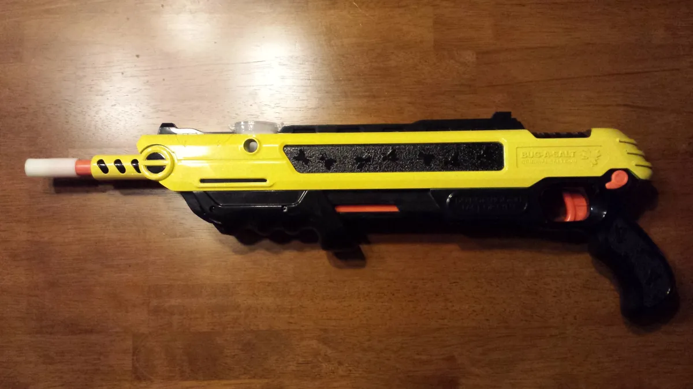
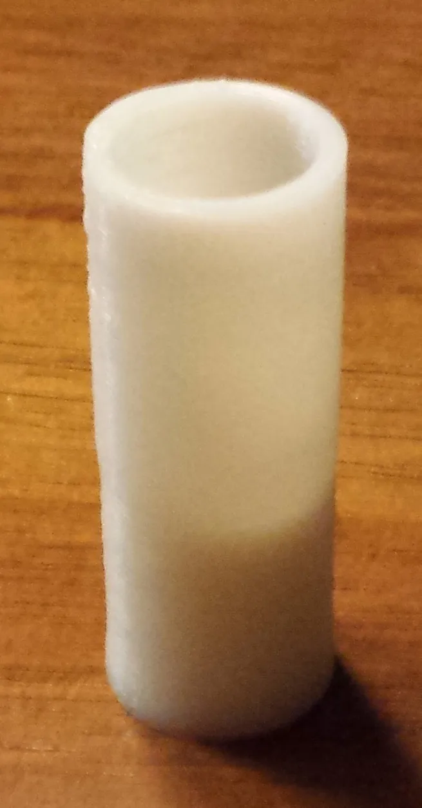
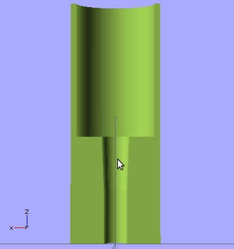

# Bug-A-Salt Choke Tube

A choke tube for the [Bug-A-Salt](https://www.bugasalt.com/), a bug gun that shoots table salt instead of toxic chemicals.

This was one of my first projects on my printer. It works just like a choke tube on a shotgun: it gradually narrows the barrel to group the shot, or in this case salt, more tightly. You have to aim a little better, but it does a lot more damage to whatever you hit, so you can take down bigger bugs in fewer shots.

## Printing

This is a very easy and fairly fast print. `bug_a_salt_choke.scad` is fully parameterized. You might need to play with the settings a little to get it to fit snugly over the Bug-A-Salt barrel. The defaults work well on my printer. You can also make it longer or shorter, or make the choke wider or narrower.

Once it's printed, the choke slides over the end of the barrel. You can remove it just as easily if you want a wider spread.

*Originally written in 2013.* More of my projects: https://pwntato.github.io
